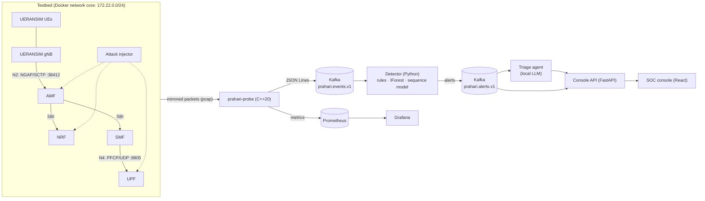

# Architecture — Prahari-5GC

## 1. System overview



The design is **passive and one-way**: packets are copied to the probe; nothing
downstream can affect the core. A probe crash loses visibility, never service.

## 2. Components

| Component | Language / tech | Responsibility | Phase |
|---|---|---|---|
| Testbed | Open5GS v2.7.x, UERANSIM v3.2.x, MongoDB, Docker Compose | Real 5G SA core + simulated RAN; subscriber provisioning | 1 |
| Capture | tcpdump/libpcap on the `core` bridge | Copy N2/N4/SBI packets without touching the NFs | 1–2 |
| `probe/` | C++20, CMake, libpcap, nghttp2 (HPACK), librdkafka, GoogleTest, libFuzzer | Decode, correlate, pseudonymise, emit events | 0, 2, 3 |
| `schemas/` | JSON Schema 2020-12 | The event contract between C++ and Python | 0 |
| `attacks/` | Python (scapy, pycrate, httpx[h2]) | 12 attack scenarios + benign traffic profile, all labelled | 4 |
| `analytics/` | Python 3.11+, pydantic v2, scikit-learn, PyTorch | Dataset builder, detectors, streaming scorer, evaluation | 0, 4–6 |
| `triage/` | Python, Ollama (local LLM) | Turn an alert + evidence into a structured incident summary | 7 |
| `console/` | FastAPI + React/Vite (TypeScript) | Live alert timeline, drill-down, triage view | 8 |
| `deploy/` | Compose, Prometheus, Grafana | Run everything with one command; ops dashboards | 1, 8, 9 |

## 3. Data flow, one message end-to-end

1. The SMF sends a PFCP *Session Establishment Request* to the UPF (UDP 8805).
2. The capture point copies the frame. The probe reads it via libpcap.
3. Probe pipeline: link layer → IPv4/IPv6 → UDP → `pfcp::decode` → IE walk → F-SEID → session table update.
4. The probe builds a `SignallingEvent` (see `schemas/event.v1.schema.json`), hashes any SUPI with HMAC-SHA256, and produces it to Kafka.
5. The detector consumes events, updates per-UE / per-session / per-peer state and windows, and scores them.
6. Above threshold → an alert (with the evidence event IDs) goes to `prahari.alerts.v1`.
7. The triage agent reads the alert plus its evidence and writes a summary: what happened, which 3GPP procedure was abused, likely impact, suggested next step.
8. The console streams alerts and summaries to the analyst over WebSocket.

## 4. Probe internals (C++)

```
pcap source ─▶ L2/L3/L4 parse ─▶ demux by port/proto ─┬─▶ PFCP decoder  ─┐
 (live/offline)                                       ├─▶ NGAP decoder ─▶ NAS decoder
                                                      └─▶ HTTP/2 + HPACK ─┤
                                                                          ▼
                                       correlation tables (UE, SEID, stream)
                                                                          ▼
                                       event builder ─▶ JSON ─▶ sink (stdout | file | Kafka)
                                                                          │
                                       stats snapshot (1 s) ─▶ /metrics (Prometheus)
```

### SBI: TCP, HTTP/2, HPACK

| Layer | What the probe keeps per connection | Bounds |
|---|---|---|
| TCP | Next expected sequence per direction, out-of-order segments | 256 KiB / 128 segments per direction, 1 MiB ahead, 4096 flows, 30 min idle |
| HTTP/2 | Partial frame, header block in progress, open streams (request kept until its response) | 1 MiB frame, 64 KiB header block, 1024 streams, 16 KiB of each body |
| HPACK | One nghttp2 inflater per direction (dynamic table) | nghttp2 limits + SETTINGS_HEADER_TABLE_SIZE |

Decoding starts at a SYN. A gap that cannot be filled, a framing error or an HPACK
error abandons the connection (one `malformed` event); it is never resynchronised by
guessing. Each completed request and response becomes one event named after its 3GPP
service operation, with identity path segments replaced and the IMSI (from path or
body) turned into the same `supi_hash` used on N2 and N4.

### N4 session table

PFCP addresses every session message to the *receiver's* SEID, so one session has two
identifiers and no single message carries both after setup. The probe links them:

| Message | Header SEID | F-SEID IE | Table action |
|---|---|---|---|
| 50 Establishment Request (SMF→UPF) | 0 | CP SEID | create, `establishing` |
| 51 Establishment Response (UPF→SMF) | CP SEID | UP SEID | link UP SEID, `active` |
| 52/54 Modification/Deletion Request | UP SEID | — | look up by (UPF IP, UP SEID) |
| 53/55 Responses | CP SEID | — | look up by (SMF IP, CP SEID); 55 accepted → `deleted` |

Keys include the receiving node's IP, so the same SEID at two UPFs is two sessions.
A request for a SEID the table never saw is emitted with `session_known: false`,
the raw signal for attack N4-01 (spoofed deletion). Capacity is bounded and unanswered
establishments expire after 30 s.

### N2 UE table and NAS ciphering

NGAP identifies a UE by a pair of IDs that appear at different times: the gNB picks
RAN-UE-NGAP-ID in InitialUEMessage, the AMF adds AMF-UE-NGAP-ID in its first downlink
message. The probe keys the UE on (gNB IP, RAN-UE-NGAP-ID) and records the AMF ID when
it appears.

| Seen on N2 | UE table action |
|---|---|
| InitialUEMessage + Registration Request (SUCI, null scheme) | create; IMSI → `HMAC-SHA256(key, "imsi-…")` → `supi_hash`; IMSI discarded |
| First downlink with AMF-UE-NGAP-ID | link AMF ID |
| Security Mode Command (NAS) | store the selected cipher; NEA0 bodies stay decodable |
| Any later message for the UE | copy `ran/amf_ue_ngap_id` and `supi_hash` into `ev.ue` |
| UEContextReleaseComplete | remove |

Without `PRAHARI_SUPI_KEY` (≥ 16 bytes) the probe drops identities rather than hash
them with a guessable default. The table is bounded and entries idle for 1 h expire.

Rules every decoder follows (enforced by `rules.md` and tests):

- Input is a `std::span<const std::uint8_t>`; reads go through `ByteReader` (bounds-checked by construction).
- Malformed input returns `Result<T>` with a `DecodeError`. No exceptions, no asserts on input data.
- A malformed message is still emitted as an event with `decode_status != ok`: malformed signalling is evidence.
- Each decoder has unit tests from spec-built vectors, real-capture vectors (from Phase 2), and a libFuzzer target run in CI.

## 5. Folder structure

```
prahari-5gc/
├── PRD.md  Architecture.md  rules.md  design.md  task.md  memory.md
├── README.md  LICENSE  Makefile
├── probe/                    C++20 passive probe
│   ├── CMakeLists.txt  CMakePresets.json  cmake/
│   ├── include/prahari/      public headers (ByteReader, Result, decoders)
│   ├── src/                  implementations + main.cpp (CLI)
│   ├── tests/                GoogleTest unit tests
│   └── fuzz/                 libFuzzer targets + seed corpora
├── analytics/                Python package prahari_analytics
│   ├── src/prahari_analytics/
│   └── tests/
├── schemas/                  event contract + examples
├── testbed/                  (Phase 1) compose, Open5GS/UERANSIM configs, provisioning
├── attacks/                  (Phase 4) injector + benign generator
├── triage/                   (Phase 7) LLM triage agent
├── console/                  (Phase 8) FastAPI + React
├── deploy/                   (Phase 1+) Prometheus, Grafana, release compose
├── docs/
│   ├── adr/                  architecture decision records
│   └── threat-model.md       attack catalogue + adversary model
├── scripts/                  check-host.sh and helpers
├── docker/                   dev image
└── .devcontainer/  .github/workflows/
```

## 6. Network plan (testbed)

| Network | Subnet | Purpose |
|---|---|---|
| `core` (Docker bridge `prahari-core`) | 172.22.0.0/24 | All NFs, gNB, UEs, injector |
| `obs` (Docker bridge `prahari-obs`) | 172.23.0.0/24 | Kafka (later Prometheus, Grafana); unreachable from `core` |
| UE pool (Open5GS `ogstun`) | 10.45.0.0/16 | IPs assigned to UEs' PDU sessions |

| NF | IP | Ports |
|---|---|---|
| AMF | 172.22.0.5 | NGAP 38412/sctp, SBI 7777/tcp |
| SMF | 172.22.0.7 | PFCP 8805/udp, SBI 7777/tcp |
| UPF | 172.22.0.8 | PFCP 8805/udp, GTP-U 2152/udp |
| NRF | 172.22.0.10 | SBI 7777/tcp |
| AUSF, UDM, UDR, PCF, NSSF, BSF | 172.22.0.11–16 | SBI 7777/tcp |
| MongoDB | 172.22.0.30 | 27017 (internal only, no host port) |
| gNB | 172.22.0.20 | NGAP client, GTP-U |
| UE simulator (UERANSIM) | 172.22.0.21 | UEs ×N, `uesimtunN` interfaces |
| Provisioning (one-shot) | 172.22.0.31 | — |
| Attack injector | 172.22.0.40 | — |
| Capture sidecar | host netns | tcpdump on bridge `prahari-core` |
| Probe | host netns | captures on `prahari-core`; Kafka client to 172.23.0.10; `/metrics` on 9464 |
| Kafka (KRaft, single node) | 172.23.0.10 | 9092 (internal only); topic `prahari.events.v1`, 3 partitions |
| Kafka topic init (one-shot) | 172.23.0.11 | — |

Kafka, Prometheus and Grafana live on the separate `obs` network. The probe runs in the
host network namespace, which sees both bridges, so it captures on `core` and produces
to `obs` without joining either. Compose starts Kafka, then the probe and capture, then
the NRF and the rest of the core (ADR-0007): SBI's HPACK can only be decoded from a
connection's first byte.

## 7. Tech stack and why

| Choice | Why | ADR |
|---|---|---|
| Open5GS + UERANSIM | Most widely used open-source 5G SA pair; 3GPP Rel-17; used by the NWDAF research we build on | 0001 |
| C++20 probe | Line-rate parsing of hostile input; the language C-DOT's core teams use; deterministic memory | 0002 |
| JSON Lines on Kafka + JSON Schema | Debuggable, language-neutral, schema-checked on both sides; binary format only if measurements demand it | 0003 |
| Python analytics | PyTorch/scikit-learn ecosystem; fast iteration on models | 0004 |
| Docker Desktop (WSL2) | Matches the dev laptop; preflight + documented fallback | 0005 |
| Local LLM (Ollama) | Signalling metadata stays on the machine; advisory-only role | 0006 |

## 8. Cross-cutting concerns

- **Privacy:** SUPI/IMSI never leaves the probe in clear (keyed hash). Raw pcaps are git-ignored.
- **Observability:** the probe exports counters (packets, decode errors per protocol, Kafka lag/drops) to Prometheus from Phase 3.
- **Reproducibility:** pinned image tags and source versions; every dataset run records `run_id`, git SHA, and attack parameters.
- **Security of Prahari itself:** console behind auth from day one; Kafka/Mongo not exposed on host ports; no secrets in the repo (`.env` git-ignored).
