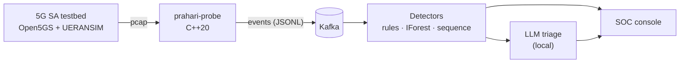

# Prahari-5GC

**Signalling-attack detection for 5G Standalone core networks.**
A private 5G testbed (Open5GS + UERANSIM), a passive C++20 probe that decodes the
core's control plane (NGAP, NAS-5GS, PFCP, HTTP/2 SBI), and an analytics layer
that detects attacks, measures its own robustness, and explains each alert in
terms of the 3GPP procedure being abused.

> Status: **Phase 0 (foundation)**. See [`task.md`](task.md) for the roadmap.
> Results tables will appear here only when a committed script produces them.



## Why

5G cores are containerised network functions that trust each other's signalling.
An attacker inside that perimeter (a rogue gNB, a compromised NF, an exposed N4
link) can flood the AMF, delete users' sessions on the UPF, or register a fake NF
with the NRF. Prahari watches those interfaces and catches it. Full reasoning in
[`PRD.md`](PRD.md); attack catalogue in [`docs/threat-model.md`](docs/threat-model.md).

## Repository map

| Path | What |
|---|---|
| [`probe/`](probe) | C++20 passive probe: bounds-checked decoders, GoogleTest, libFuzzer |
| [`analytics/`](analytics) | Python: event contract, detectors, evaluation |
| [`schemas/`](schemas) | Event contract v1 (JSON Schema) + examples |
| [`docs/adr/`](docs/adr) | Architecture decision records |
| `testbed/`, `attacks/`, `triage/`, `console/` | Arrive in Phases 1, 4, 7, 8 |

## Quick start

Requirements: Docker Desktop (WSL2 backend) and VS Code with the Dev Containers extension.

1. **Check your machine can run a 5G core** (SCTP, TUN, NET_ADMIN, memory), from Git Bash or WSL:
   ```bash
   bash scripts/check-host.sh
   ```
2. **Open in the dev container**: VS Code → *Reopen in Container*. The toolchain matches CI.
3. **Build and test everything:**
   ```bash
   make check          # lint, probe (ASan + release), clang-tidy, analytics
   ```
4. **Try the probe's PFCP decoder:**
   ```bash
   ./probe/build/release/prahari-probe decode-pfcp 23320015000000000000002a00000750003c0005000a000001
   # {"ok":true,"protocol":"pfcp","message_type":50,"message":"SessionEstablishmentRequest","sequence":7,"seid":"42","priority":5,"body_len":9}
   ```

## Engineering standards

- Probe builds with `-Wall -Wextra -Wpedantic -Wconversion -Wsign-conversion -Wshadow … -Werror` on GCC and Clang.
- Every decoder: spec-built vectors, every-prefix truncation tests, a fuzz target run in CI.
- Event schema checked from both languages; a test fails if they drift.
- Subscriber identities never leave the probe in clear (keyed HMAC).

## Scope and honesty

This is a laptop testbed with a simulated RAN and an open-source core, not
carrier-grade equipment. Attacks run only against the local testbed. Limits of
each result are documented next to the result.

## License

MIT. Open5GS (AGPL-3.0) and UERANSIM (GPL-3.0) are used as separate programs
over the network and are not linked into this code.
