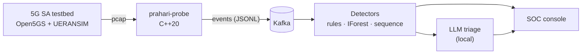

# Prahari-5GC

**Signalling-attack detection for 5G Standalone core networks.**
A private 5G testbed (Open5GS + UERANSIM), a passive C++20 probe that decodes the
core's control plane (NGAP, NAS-5GS, PFCP, HTTP/2 SBI), and an analytics layer
that detects attacks, measures its own robustness, and explains each alert in
terms of the 3GPP procedure being abused.

> Status: **Phase 5b (layered detection: rules + Isolation Forest + sequence model, fused
> into an ensemble — 9/9 attacks detected on the labelled dataset, with a streaming
> scorer)**. The probe, the 12-attack injector (N4/SBI/N2), and the labelled-dataset
> pipeline are complete. See [`task.md`](task.md) for the roadmap and
> [`docs/results/`](docs/results) for measured results (with their caveats). Results tables
> appear here only when a committed script produces them.



## Why

5G cores are containerised network functions that trust each other's signalling.
An attacker inside that perimeter (a rogue gNB, a compromised NF, an exposed N4
link) can flood the AMF, delete users' sessions on the UPF, or register a fake NF
with the NRF. Prahari watches those interfaces and catches it. Full reasoning in
[`PRD.md`](PRD.md); attack catalogue in [`docs/threat-model.md`](docs/threat-model.md).

## Repository map

| Path | What |
|---|---|
| [`probe/`](probe) | C++20 passive probe: bounds-checked decoders, GoogleTest, libFuzzer |
| [`analytics/`](analytics) | Python: event contract, labeller, dataset build (`prahari-dataset`), detection (`prahari-detect`) |
| [`schemas/`](schemas) | Event contract v1 (JSON Schema) + examples |
| [`docs/adr/`](docs/adr) | Architecture decision records |
| [`testbed/`](testbed) | Open5GS v2.7.7 + UERANSIM v3.2.8 in Compose, capture sidecar, smoke/attack/dataset scripts |
| [`attacks/`](attacks) | Attack injector (`prahari-attack`): N4/SBI/N2, allowlisted to the testbed, run manifests for labels |
| [`campaign/`](campaign) | Benign traffic + attack campaign runner (`prahari-campaign`) |
| `triage/`, `console/` | Arrive in Phases 7, 8 |

## Quick start

Requirements: Docker Desktop (WSL2 backend) and VS Code with the Dev Containers extension.

1. **Check your machine can run a 5G core** (SCTP, TUN, NET_ADMIN, memory), from Git Bash or WSL:
   ```bash
   bash scripts/check-host.sh
   ```
2. **Open in the dev container**: VS Code → *Reopen in Container*. The toolchain matches CI.
3. **Build and test everything:**
   ```bash
   make check          # lint, probe (ASan + release), clang-tidy, analytics
   ```
4. **Start the 5G network** (first build ~10 min) and check it end to end:
   ```bash
   cd testbed && cp .env.example .env && docker compose up -d --build && bash scripts/smoke.sh
   ```
5. **Watch the probe decode live N2, N4 and SBI traffic** from the running testbed:
   ```bash
   tail -f testbed/events/events.jsonl
   ```
   or run it on a capture file:
   ```bash
   ./probe/build/release/prahari-probe run --pcap probe/tests/data/n4-lifecycle.pcap --stats
   PRAHARI_SUPI_KEY=prahari-test-key-0123456789abcdef \
     ./probe/build/release/prahari-probe run --pcap probe/tests/data/n2-registration.pcap
   ```

### Measured so far

| What | Result |
|---|---|
| PFCP decoding vs tshark (1,342 real messages) | 0 mismatches |
| NGAP + NAS decoding vs tshark (2,682 real messages) | 0 mismatches |
| SBI (HTTP/2) decoding vs tshark (5,742 real messages) | 0 mismatches |
| IMSIs leaked into probe output (N2 SUCIs, SBI paths and bodies) | 0 |
| UEs traceable across N2, N4 and SBI by one pseudonym | 10 / 10 |
| Probe throughput, one 2.1 GHz core, JSON included | ~489k N2, ~371k N4, ~203k SBI msgs/s |
| Fuzzing (8 targets, ~80M inputs) | 0 crashes |
| N4/SBI attacks against real Open5GS v2.7.7 | 7 of 8 effective; UPF crash reproduced (CVE-2026-106807) |
| Spoofed attack messages attributed exactly by the labeller | 102,302 / 102,302 |
| N2 (NGAP/NAS) encoders vs real testbed PDUs (pycrate round-trip) | byte-identical; every generated PDU decodes in the C++ probe |
| Labelled dataset pipeline (events → typed Parquet + card) | 40 columns, schema-validated, class balance in the card |
| Rules detector on the labelled dataset (identity-free, behavioural) | 8/9 attacks detected, precision 1.000, 0% held-out false positives |
| Ensemble detector (rules + Isolation Forest + sequence model) | 9/9 attacks detected, F1 0.96 (single campaign; see results caveats) |
| Testbed footprint at 100 UEs | ~425 MB RAM |

## Engineering standards

- Probe builds with `-Wall -Wextra -Wpedantic -Wconversion -Wsign-conversion -Wshadow … -Werror` on GCC and Clang.
- Every decoder: spec-built vectors, every-prefix truncation tests, a fuzz target run in CI.
- Event schema checked from both languages; a test fails if they drift.
- Subscriber identities never leave the probe in clear (keyed HMAC).

## Scope and honesty

This is a laptop testbed with a simulated RAN and an open-source core, not
carrier-grade equipment. Attacks run only against the local testbed. Limits of
each result are documented next to the result.

## License

MIT. Open5GS (AGPL-3.0) and UERANSIM (GPL-3.0) are used as separate programs
over the network and are not linked into this code.
