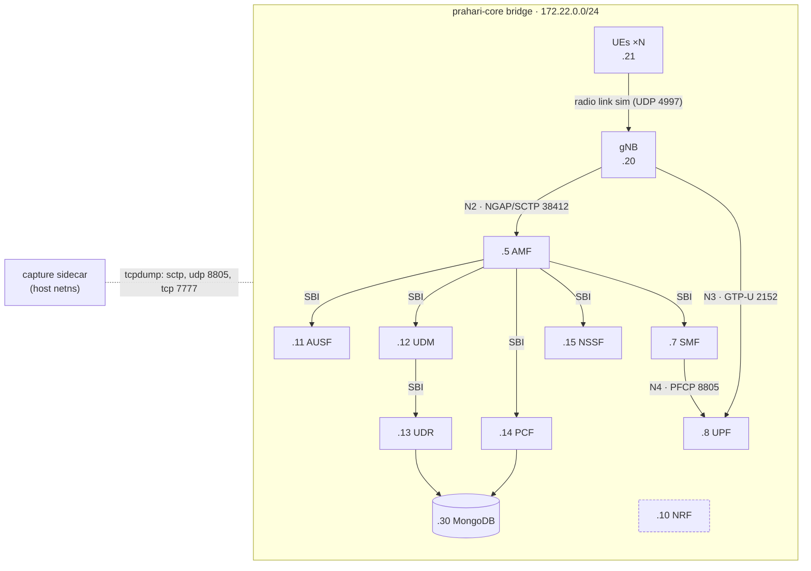

# Testbed: a 5G Standalone network on one laptop

Open5GS **v2.7.7** (5G core) and UERANSIM **v3.2.8** (gNB + UEs), both built from
pinned, commit-verified source, wired together with Docker Compose. A capture
sidecar records the control plane (N2, N4, SBI) for the probe.



Every NF registers with the NRF (dashed) and discovers peers through it.

## Run it

Prerequisites: `bash scripts/check-host.sh` from the repo root passes 5/5.

```bash
cd testbed
cp .env.example .env              # adjust PRAHARI_UE_COUNT if you like
# then set PRAHARI_SUPI_KEY in .env, e.g. to the output of: openssl rand -hex 32
docker compose build nrf          # Open5GS image, built once for all NFs (~5-10 min first time)
docker compose build gnb capture  # UERANSIM + capture images (~5 min first time)
docker compose build probe        # Prahari probe (~1-2 min)
docker compose up -d              # Kafka -> probe + capture -> NRF -> the rest of the core
bash scripts/smoke.sh             # end-to-end checks
```

A passing smoke test looks like:

```
  [ OK ] all 13 services healthy
  [ OK ] subscribers provisioned (total in db: 10)
  [ OK ] gNB completed NG Setup with the AMF (N2/SCTP up)
  [ OK ] 10/10 UEs registered with a PDU session
  [ OK ] user plane: UE -> gNB -> UPF ping to 10.45.0.1
  [ OK ] capture recording N2=... N4=... SBI=... packets in core-....pcap
  [ OK ] probe: ... N4 events, 10 sessions active, 0 decode errors
  [ OK ] probe: 10 N2 registrations decoded, 10 SUPIs pseudonymised, 0 IMSIs leaked
  [ OK ] probe: ... SBI events, 10 AMF registrations, 10 UEs linked N2<->SBI
  [ OK ] kafka: ... events in prahari.events.v1; metrics: ... delivered, 0 dropped
Result: 10 passed, 0 failed
```

**Start order matters for SBI.** The core keeps its HTTP/2 connections open for its
whole life, and their compressed headers (HPACK) can only be decoded from a
connection's first byte. Compose therefore starts the probe before the core. If you
rebuild or restart only the probe, its SBI view goes blind for connections that are
already open (smoke check 10 tells you); restart everything instead:

```bash
docker compose down && docker compose up -d
```

**Attacks (Phase 4).** The injector runs in its own container at 172.22.0.40, only when
asked for (`--profile attack`), and refuses any address outside 172.22.0.0/24. After the
smoke test, `bash scripts/attack-check.sh` runs the non-destructive scenarios and checks
that the probe captured them and the labeller attributed every one. Manifests and
labelled events land in `runs/` (git-ignored). See `attacks/README.md`.

```bash
docker compose --profile attack up -d --build attacker
docker compose exec attacker prahari-attack list
bash scripts/attack-check.sh
```

Useful commands:

| Task | Command |
|---|---|
| Follow AMF registrations | `docker compose logs -f amf` |
| UE interfaces | `docker compose exec ue ip -br addr` |
| Ping from a UE | `docker compose exec ue ping -I uesimtun0 10.45.0.1` |
| UERANSIM CLI | `docker compose exec gnb nr-cli --dump` |
| Change UE count | edit `.env`, then `docker compose up -d --force-recreate provision ue` |
| Resource profile | `bash scripts/profile.sh 10 50 100` → `docs/results/testbed-profile.md` |
| Live probe events | `tail -f events/events.jsonl` |
| UE pseudonyms seen | `grep -o '"supi_hash":"[0-9a-f]*"' events/events.jsonl \| sort -u` |
| Events on Kafka (last 5) | `docker compose exec kafka /opt/kafka/bin/kafka-console-consumer.sh --bootstrap-server 172.23.0.10:9092 --topic prahari.events.v1 --from-beginning --max-messages 5` |
| Probe metrics | `docker compose exec probe bash -c 'exec 3<>/dev/tcp/127.0.0.1/9464; printf "GET /metrics HTTP/1.0\r\n\r\n" >&3; cat <&3'` |
| Probe statistics | `docker compose restart probe && docker compose logs probe` (printed at stop) |
| Stop (keep DB) | `docker compose down` |
| Stop and wipe DB | `docker compose down -v` |

Captures land in `testbed/captures/` (git-ignored) and rotate every
`CAPTURE_ROTATE_SECONDS`. Open them in Wireshark; on port 7777, use
*Decode As → HTTP2* to see SBI calls.

## What starts when

```
kafka ── kafka-init (topic) ── probe ─┐            (obs network 172.23.0.0/24)
capture ──────────────────────────────┴─ nrf      (probe + capture in host netns)
mongo ─┬─ provision (one-shot: N subscribers)
       ├─ udr ─┐
       └─ pcf ─┤
nrf ──── ausf, udm, nssf, bsf ─┤
upf ──── smf ──────────────────┴─ amf ── gnb ── ue (after provision succeeds)
```

Health checks gate each arrow: SBI NFs are healthy once their HTTP/2 server
accepts TCP on :7777; the UPF once `ogstun` exists; UEs once `uesimtun0` is up.

## Design choices

- **Built from source, pinned by commit.** The Dockerfiles check `git rev-parse HEAD`
  against the expected commit, so a moved tag fails the build instead of silently
  changing the network under test.
- **Fixed IPs per NF.** The probe maps IP → NF name without any lookup.
- **Least privilege.** NFs run as an unprivileged `open5gs` user with
  `no-new-privileges`. Only the UPF and UE container get `NET_ADMIN` + `/dev/net/tun`.
  No service publishes a host port; MongoDB binds only to the bridge.
- **Keys from `.env`.** Subscriber K/OPc are injected at start-up and never committed.
  The defaults are the public UERANSIM example values.
- **Direct NRF discovery, no SCP.** Fewer moving parts, and SBI traffic flows NF→NF,
  which is what the attacks in Phase 4 target.

## Verified so far

In the build sandbox (Ubuntu 24.04, no SCTP or IPv6 in its kernel) these configs were
run against the real Open5GS v2.7.7 and UERANSIM v3.2.8 binaries:

- NRF, AUSF, UDM, NSSF, BSF and SMF registered with the NRF; SMF↔UPF **PFCP associated**.
- AMF, UDR and PCF parsed their configs. AMF then needs SCTP; UDR and PCF need MongoDB.
- gNB and UE parsed their configs. gNB then needs SCTP; UE needs IPv6 sockets.
- The probe decoded all 11 captured PFCP messages identically to tshark.

On the dev laptop (Windows, Docker Desktop with WSL2 at 8 GB) `scripts/smoke.sh`
passes 6/6: NG Setup over SCTP, 10/10 UEs registered with PDU sessions, user-plane
ping through the UPF, and capture of N2, N4 and SBI. CI repeats it on every PR.

On Windows, run the scripts from **Git Bash**. `bash` typed in PowerShell starts
WSL's bash, which has no Docker access.

## Troubleshooting

| Symptom | Cause | Fix |
|---|---|---|
| `udr`/`pcf` restarting | MongoDB not ready | They retry; check `docker compose logs mongo` |
| gNB: `SCTP socket could not be created` | Docker kernel without SCTP | Re-run `scripts/check-host.sh`; see ADR-0005 fallback |
| UE stuck at `PLMN selection` / no cell | gNB not up or wrong `gnbSearchList` | `docker compose logs gnb`; NG Setup must succeed first |
| AMF: `Cannot find SUCI` / auth failure | Subscriber not provisioned or K/OPc mismatch | `docker compose logs provision`; same `.env` for both |
| UE registered but ping fails | UPF `ogstun` or GTP-U issue | `docker compose logs upf`; `docker compose exec upf ip addr show ogstun` |
| No pcaps in `captures/` | Capture can't see the bridge | `docker compose logs capture`; it must show `listening on prahari-core` |
| `required variable SUBSCRIBER_K is missing` | No `.env` | `cp .env.example .env` |
| Memory pressure | Too many UEs for WSL2 | Lower `PRAHARI_UE_COUNT`; WSL2 memory is set in `~/.wslconfig` |
| Image build crawls for an hour+ | Too many compile jobs for WSL2 RAM (swapping) | Build one image at a time; lower `BUILD_JOBS` in `.env` (e.g. 2) |
| `pull access denied for prahari/...` | Image not built yet | Run the `docker compose build` steps above first |
